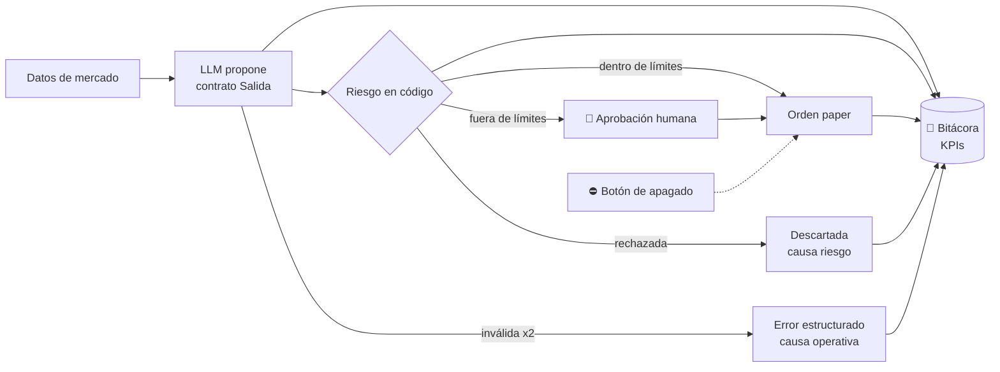

# Proceso futuro (TO-BE) a partir del AS-IS de la PE1

Responde al punto 5 de la devolución de la PE1. Parte de los mismos 8 pasos del AS-IS y marca dónde quedan la **aprobación**, el **registro** y el **apagado**. La columna "Pieza" indica qué parte del sistema lo resuelve y en qué módulo se construye.

| # | Paso AS-IS (PE1) | Problema medido | Paso TO-BE | Pieza | Módulo |
|---|---|---|---|---|---|
| 1 | Rutina de la mañana: macro y noticias | Precios con 15 min de retraso; fuentes no declaradas | La mesa actual sigue aportando contexto; el bot usa datos de mercado declarados | `datos_mercado.py` (hoy, velas públicas); proveedor en tiempo real a definir | PE2 / pendiente |
| 2 | Propuesta de activos y fichas | — | Un activo (SPY) y una estrategia definida por el equipo | Configuración de la estrategia | Semana 4 |
| 3 | Filtro de riesgo (semáforo) | Reglas en el modelo, se erosionan | **Reglas de riesgo en código**, versionadas | `riesgo.py` (`reglas-v0.2`) | **PE2** ✅ |
| 4 | Objeciones (agente en contra) | Veta sin registro; posible culpable de no ejecutar | El LLM propone con un contrato estricto; no hay veto sin motivo registrado | `contratos.py`, `prompts.py` | **PE2** ✅ |
| 5 | Plan del día · **cuello de botella** | 3 de 5 señales frenadas por causas operativas | Propuesta → validación → decisión de riesgo en segundos. Dentro de límites, sigue sola; fuera de límites, 🔔 **aprobación por excepción** | `motor.py`; aprobación por Telegram | **PE2** ✅ / M5 |
| 6 | Ejecución si el precio toca la entrada | Solo si la VM está activa (34 % pausada) | Orden al bróker paper desde un servicio en la nube con monitoreo; ⛔ **botón de apagado** < 1 min | Cliente de Alpaca, despliegue | Semana 4 / M5 / M8 |
| 7 | Reporte diario | Sin registro único | 📒 **Bitácora única** con cada etapa, hora, versión, autor y motivo → reporte diario antes de las 19:00 | `bitacora.py` (KPIs ya calculados) | **PE2** ✅ / M8–M9 |
| 8 | Ajuste semanal a mano | Una semana para ver el efecto | Cambio de reglas o de prompt → eval contra escenarios históricos → 🔔 **aprobación** → activo, con versión anterior guardada | Evals | M6 |

